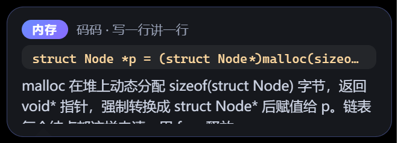
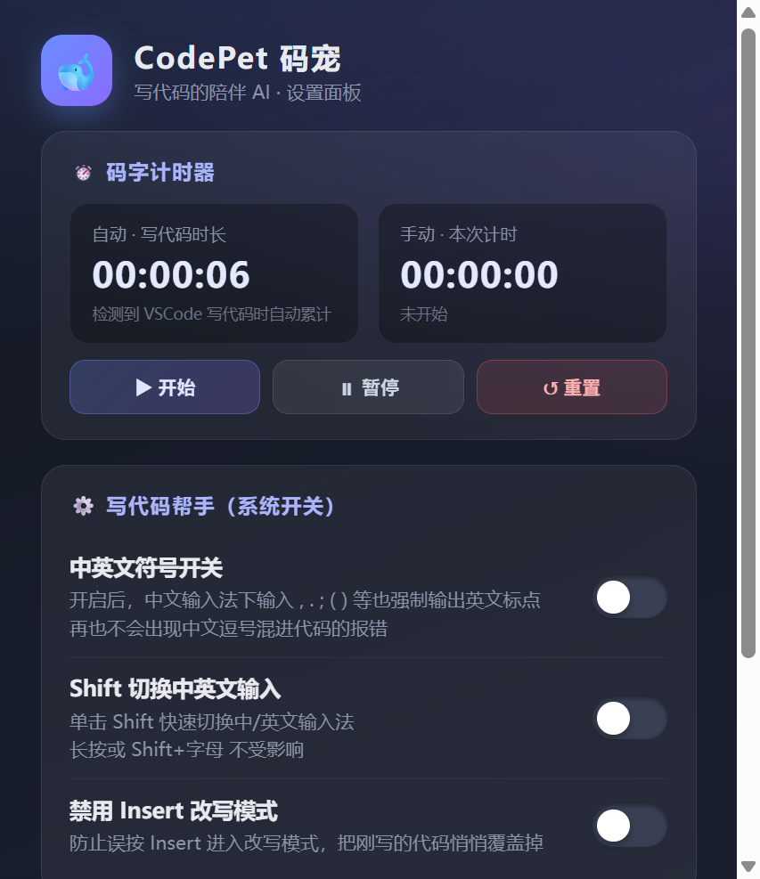

# 🐾 CodePet 码宠 · 写代码的陪伴 AI

> **写一行，讲一行。** 一个会在你写代码时守在桌面上、帮你把每一行 C/C++ 讲明白的陪伴型 AI —— 专为考研 408 手写代码场景打造。


## 为什么做它

备考 408 的同学常被两件事卡住：

1. **代码看不懂** —— 手写链表、二叉树、递归时，每一行都要想半天"这行到底在干嘛"；
2. **基础不牢** —— 指针、malloc、结构体、位运算这些知识点写的时候总是含糊。

市面上的 AI 助手大多是"对话框问答式"：写完一整段代码再去问，学习被打断，也没人陪。CodePet 反着来——**你写一行，它讲一行**，讲解直接出现在桌宠的气泡里，像有个学伴在旁边陪你刷题。

## 三合一功能

| 模块 | 技术 | 作用 |
|---|---|---|
| 🧠 VSCode 插件 | TypeScript/JS，纯本地规则引擎 | 每写一行完整语句，自动生成中文教学注释；悬停即讲 |
| 🐱 桌面桌宠 | Electron 透明置顶窗口（改造自开源项目） | 写代码时在桌面陪伴：活跃时奔跑、空闲时待机，气泡讲解代码 |
| 🎛️ 系统开关 | AutoHotkey v2 | 中英文符号开关 / Shift 切换中英 / 禁用 Insert 改写，写代码少踩坑 |

三者通过**本地桥接服务**（`127.0.0.1:48672`）联动，全部数据留在本机，不联网、无隐私问题。

```
┌─────────────┐  POST  ┌──────────────┐  GET   ┌──────────────┐
│ VSCode 插件 │ ─────► │ 本地桥接服务  │ ◄───── │  桌面桌宠     │
│ 规则引擎    │ status │ 127.0.0.1:48672│ bubble │ 奔跑/待机/气泡│
└─────────────┘        └──────────────┘        └──────────────┘
                              ▲ 独立运行
                    ┌─────────┴─────────┐
                    │ 系统开关(AHK 脚本) │
                    └───────────────────┘
```

## 功能详解

### 1. VSCode 插件：写一行，讲一行

- 内置 **29 类 C 语言规则**：变量声明、函数、结构体、typedef、指针、链表（`p = p->next`）、动态内存（malloc/calloc/realloc/free）、循环、条件、switch、位运算、自增、赋值……覆盖 408 手写代码高频语法
- 写完整语句后**自动在行尾插入中文注释**（可关闭）
- **悬停解释**：鼠标移到任意代码行，立即弹出该行讲解
- 命令面板：`CodePet：解释当前行` / `CodePet：开关自动注释`
- **纯本地规则引擎**，零依赖零联网，预留大模型 API 结构可升级

```c
LinkList L = (LinkList)malloc(sizeof(struct Node));  // 动态内存：为结构体 Node 分配一块堆内存，首地址存入 L
L->next = NULL;                                       // 指针解引用：将 L 指向节点的 next 字段置空，防止野指针
for (int i = 0; i < n; i++) {                         // 循环：i 从 0 递增到 n-1，共执行 n 次
```

### 2. 桌面桌宠：写代码时陪你

- 透明置顶、**可自由拖动**（按住猫猫就能"拎出来"放到任意位置，不再吸附屏幕边缘）
- **只保留一只三花猫**：安静的学伴，不花哨
- **VSCode 联动模式**：你在写代码时它**原地奔跑**，停下思考时它**待机休息**——像真的在陪你
- **讲解气泡**：插件识别代码后，桌宠弹出气泡（内存 / 循环 / 指针等标签 + 代码行 + 大白话解释），7 秒自动消失
- **右键猫猫**弹出迷你菜单（设置面板 / 重启 / 退出，与设置面板同款视觉）
- 托盘菜单可切换模式、**重启桌宠**、打开设置面板



### 2.1 码字计时器（v0.2.0 新增）

设置面板内置两个计时维度，纯本地统计、重启不丢：

| 模式 | 说明 |
|---|---|
| 自动 · 写代码时长 | 检测到 VSCode 里在写代码时自动累计，打开设置面板即可看到今天写了多久 |
| 手动 · 本次计时 | 点击「开始 / 暂停 / 重置」，自己掐表记录一次刷题/写代码的时长 |

计时数据保存在本机 `code-pet-timer.json`，不联网。

### 3. 系统开关：写代码少踩坑

在桌宠设置面板一键启停三个 AHK 开关（每个开关也可独立用脚本运行）：

| 开关 | 效果 |
|---|---|
| 中英文符号开关 | 中文输入法下输入 `;` `,` `()` 等也强制输出英文标点，不再有中文逗号混进代码的报错 |
| Shift 切换中英文 | 单击 Shift 快速切中/英，长按或 Shift+字母不受影响 |
| 禁用 Insert 改写 | 防止误按 Insert 进入改写模式，悄悄覆盖刚写的代码 |



## 快速开始

### 方式 A：直接跑桌宠（最快看到效果）

```powershell
cd pet
npm install        # 若下载 Electron 慢，先执行:
# $env:ELECTRON_MIRROR="https://npmmirror.com/mirrors/electron/"
npm start
```

启动后桌宠默认进入 VSCode 联动模式，会在桌面上待机等待。

### 方式 B：安装 VSCode 插件

1. 打开 VSCode，`Ctrl+Shift+X` 搜索 `CodePet`（发布到市场后），或：
2. 本地安装：`code --install-extension code-pet-vscode-0.1.0.vsix`（见打包说明）
3. 打开任意 `.c` / `.cpp` 文件开始写代码，注释与桌宠气泡自动出现

### 方式 C：单独使用系统开关

```powershell
# 需要先安装 AutoHotkey v2：winget install AutoHotkey.AutoHotkey
& "$env:LOCALAPPDATA\Programs\AutoHotkey\v2\AutoHotkey64.exe" pet\switches\code-switches.ahk --symbol
```

也可以直接在桌宠设置面板里点开关，无需手动运行。

## 项目结构

```
code-pet/
├── vscode-extension/          # VSCode 插件（纯本地规则引擎）
│   ├── extension.js           # 插件主逻辑：自动注释 / Hover / 命令 / 桥接推送
│   ├── lib/analyzer.js        # 29 类 C 语言规则引擎（核心）
│   ├── lib/commentator.js     # 中文教学注释生成器
│   ├── lib/bridge.js          # 本地桥接 HTTP 服务（48672 端口）
│   └── tests/analyzer.test.js # 44 个单元测试，全部通过
├── pet/                       # 桌面桌宠（Electron）
│   ├── main.js                # 主进程：联动模式 / 气泡 / 设置面板 / 重启 / 计时器 / AHK 子进程管理
│   ├── index.html             # 桌宠角色渲染（猫猫，可拖动拎出 / 右键菜单）
│   ├── menu.html              # 右键迷你菜单（与设置面板同视觉）
│   ├── bubble.html            # 讲解气泡窗口
│   ├── settings.html          # 设置面板（码字计时器 + 三开关 + 重启）
│   └── switches/code-switches.ahk  # 系统开关脚本
└── docs/                      # 图文教程与创作说明
```

## 技术亮点

- **纯本地**：规则引擎 + 桥接服务全部跑在本机，不依赖网络与大模型，隐私友好、秒级响应
- **可扩展**：规则引擎预留大模型 API 结构，后续接入 LLM 即可从"规则讲解"升级为"智能讲解"
- **不重复造轮子**：桌宠基于 GitHub 开源项目改造（MIT），AHK 开关复用 AutoHotkey 生态，专注做"写一行讲一行"的差异化体验
- **验证扎实**：规则引擎 44 个单元测试全过；桥接字段映射 bug 已修复并通过最小复现验证；桌宠渲染、活跃联动、讲解气泡、设置面板开关全部实测通过；v0.2.0 新增的重启、拖动拎出、右键菜单、码字计时器均已在真实进程上验收

## 开源致谢

- 桌宠改造自 [sunwood-ai-labs/desktop-pet-mitarashi](https://github.com/sunwood-ai-labs/desktop-pet-mitarashi)（MIT License）
- 系统开关基于 [AutoHotkey v2](https://www.autohotkey.com/) 生态
- 本项目同样以 MIT License 开源

## 创作说明

[📄 创作说明（300 字内）](docs/CREATION_NOTES.md) · [📖 图文教程（1000-2000 字）](docs/TUTORIAL.md)

---

> 一起加油，408 考研人！ 🐾
