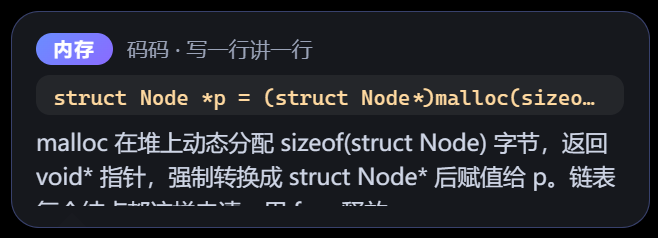
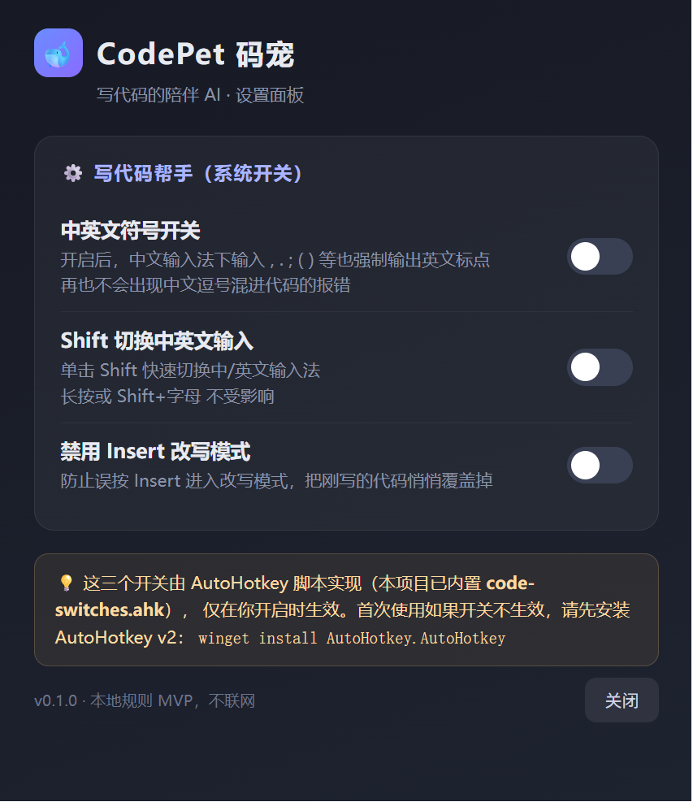

# CodePet 码宠 · 图文教程

> 跟着这篇教程，15 分钟搭好你的"写代码陪伴 AI"：VSCode 自动注释 + 桌面桌宠 + 系统开关。

## 0. 这个项目能干嘛？

备考 408 手写代码时，CodePet 在你身边做三件事：

- 你每写一行完整语句，VSCode 里**自动出现中文教学注释**；
- 桌面上的小猫/企鹅**在你写代码时奔跑活跃**，停下来时待机休息；
- 识别结果以**讲解气泡**的形式从桌宠弹出，把这一行"翻译"成大白话。

全程本地运行、不联网。

## 1. 环境准备

| 软件 | 用途 | 安装 |
|---|---|---|
| Node.js ≥ 20 | 运行桌宠 | [nodejs.org](https://nodejs.org) 下载 LTS 安装 |
| VSCode | 写代码 | 已装则跳过 |
| AutoHotkey v2 | 系统开关 | `winget install AutoHotkey.AutoHotkey`（可选，只用前两功能可跳过） |

## 2. 第一步：跑起桌宠

```powershell
cd pet
npm install
npm start
```

如果 `npm install` 下载 Electron 太慢，先设置镜像再装：

```powershell
$env:ELECTRON_MIRROR="https://npmmirror.com/mirrors/electron/"
npm install
```

启动后，屏幕上出现一只三花猫（或企鹅）——它现在处于"待机"状态，等你去写代码。


## 3. 第二步：安装 VSCode 插件

```powershell
cd vscode-extension
npm test                 # 先跑 44 个单元测试，确认环境 OK
code --install-extension ../pet/dist/CodePet-0.1.0.vsix   # 见文末打包说明
```

装好后打开任意 `.c` 文件开始写代码。插件默认开启了"自动注释"：写完一行完整语句，行尾自动补上中文注释，例如：

```c
LinkList L = (LinkList)malloc(sizeof(struct Node));  // 动态内存：为结构体 Node 分配堆内存，首地址存入 L
```

鼠标悬停到任意代码行，还会弹出这行代码的讲解。不想自动补注释时，命令面板输入 `CodePet：开关自动注释` 即可关闭。

## 4. 第三步：联动桌宠

插件会把识别结果推送到本地桥接服务（`127.0.0.1:48672`），桌宠每 3 秒轮询一次：

- **活跃**：你正在写代码 → 桌宠切换为奔跑动画；
- **空闲**：超过 8 秒没动 → 桌宠回到待机；
- **讲解**：每次识别出新代码，桌宠弹出气泡（标签 + 代码行 + 大白话解释），7 秒后自动消失。



写一段链表代码试试：`p = p->next;` 会得到"指针遍历：p 指向下一个节点"的讲解，`malloc` 会得到"动态内存分配"的讲解——就像有个学伴实时给你讲题。

## 5. 第四步：打开系统开关

右键任务栏托盘里的桌宠图标 → 设置面板（也可用 `npx electron . --open-settings` 直接打开）：



三个开关一键启停，全部由内置的 AHK 脚本实现，**只有你开启时才生效**：

1. **中英文符号开关**：中文输入法下输入 `;` `,` `()` 也强制输出英文标点，杜绝"中文逗号混进代码"；
2. **Shift 切换中英文**：单击 Shift 秒切输入法，长按不受影响；
3. **禁用 Insert 改写**：防止误按 Insert 悄悄覆盖刚写的代码。

## 6. 常见问题

**Q：桌宠没有气泡弹出？**
先确认桌宠已启动、插件设置里 `codePet.pushToPet.enabled` 为 true，再确认端口 48672 没被占用。

**Q：系统开关不生效？**
开关依赖 AutoHotkey v2，执行 `winget install AutoHotkey.AutoHotkey` 安装后重启桌宠。

**Q：想打包桌宠成 exe 分发给朋友？**
```powershell
cd pet
npx electron-builder --win
```
输出在 `pet/dist/`，便携版双击即用，无需安装。

**Q：插件想打包成 vsix 发布？**
```powershell
cd vscode-extension
npx @vscode/vsce package
```

## 7. 下一步

CodePet 目前用**纯本地规则引擎**讲解 29 类 C 语言语法（零依赖、秒级响应）。规则引擎已预留大模型 API 结构——把 `lib/analyzer.js` 的规则命中结果交给大模型润色，就能从"规则讲解"升级为"智能讲解"，这是项目后续最自然的扩展方向。
